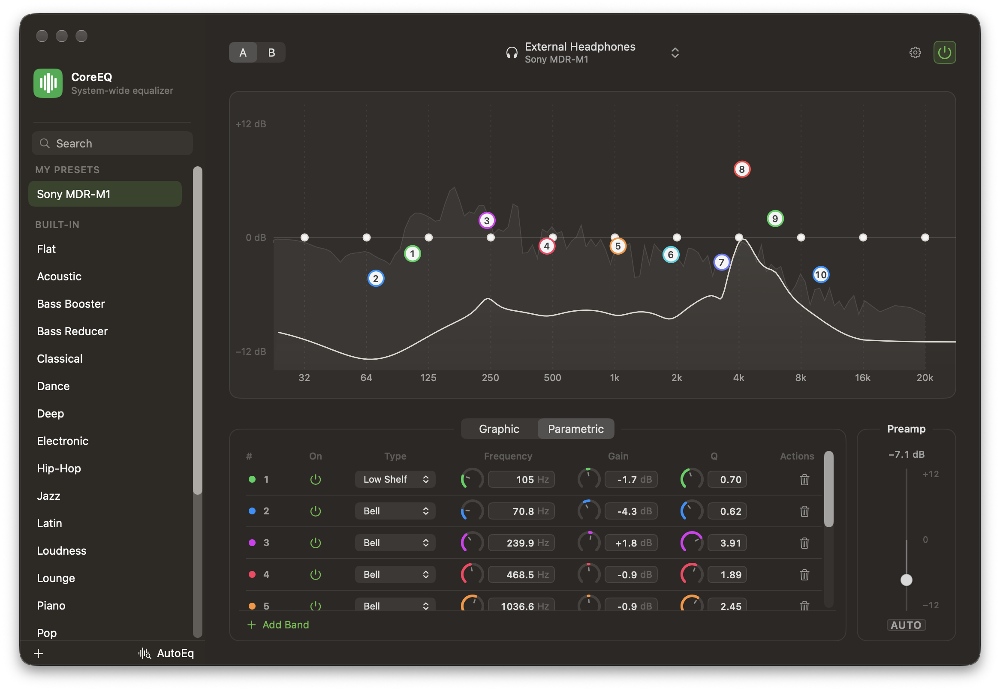

#+TITLE: CoreEQ
#+SUBTITLE: System-wide equalizer for macOS

CoreEQ equalizes *everything you hear* — music, video, calls, games — whatever
application is playing, with no virtual audio driver and no kernel extension.
It runs on Apple's native Core Audio process-tap API, so there is nothing
installed into the system and nothing left behind when CoreEQ is not running.

* Highlights

- *Every app, no driver.* Nothing is installed into the system, which you can
  verify yourself, and quitting CoreEQ hands the audio straight back.
- *Graphic and parametric in one chain.* The eleven-band ISO octave ladder, plus
  up to sixteen bells, shelves, and pass filters of your own.
- *A live, editable response graph*, drawn from the same coefficients the audio
  passes through, over a real-time spectrum analyzer.
- *Twenty-two built-in presets and your own*, each built-in with a one-line
  description of what it is for.
- *The AutoEq catalog, built in*: search thousands of headphone corrections by
  model, hear one before keeping it, and save it as a preset of your own. It
  goes online only when you open it.
- *AutoEq and EqualizerAPO import and export*, so a correction from anywhere
  else loads in a few clicks.
- *Automatic gain* holds a preset at the loudness it started from, so comparing
  presets compares their tone, not their volume.
- *A/B comparison* of two versions of the same preset.
- *Settings per output device*: your headphone curve comes back when your
  headphones do.
- *Menu bar control*, with Quick EQ bass, mid, and treble over any preset.
- *Recording-aware*: CoreEQ steps aside while a screen recording captures
  system audio, so the recording does not come out doubled.
- *Apps left alone*: exclude a DAW or any other app, and its sound goes straight
  to the output, untouched (macOS 26 or later).

Every feature is described in the [[file:docs/USER_GUIDE.org][user guide]].

* Requirements

- macOS *14.2* or later
- Permission to process system audio. CoreEQ explains what it is for, then asks

* Installation

** Homebrew (recommended)

#+begin_src sh
brew tap andreypudov/core-eq
brew trust andreypudov/core-eq
brew install --cask core-eq
#+end_src

Upgrade later with =brew update && brew upgrade --cask core-eq=.

CoreEQ is signed with its own certificate, which keeps the audio permission
across updates, but it is not notarized by Apple, so macOS may block first
launch.
Allow it in System Settings → Privacy & Security, or clear the quarantine flag:

#+begin_src sh
xattr -dr com.apple.quarantine /Applications/CoreEQ.app
#+end_src

** Build from source

Requires Xcode 26 or later. Locally built applications are not quarantined, so
CoreEQ launches with no Gatekeeper warnings:

#+begin_src sh
git clone https://github.com/AndreyPudov/core-eq.git
cd core-eq
make install
#+end_src

This builds a Release copy and installs it to =/Applications=.

** Prebuilt binary

Download the latest =CoreEQ-x.y.zip= from the *Releases* page, unzip, and move
=CoreEQ.app= to =/Applications=, then clear the quarantine flag as above.

* Getting started

1. Launch CoreEQ. A sliders icon appears in the menu bar; there is no Dock icon.
2. Allow *System Audio Recording*. CoreEQ opens its window, says what the
   permission is for, and asks when you click *Allow…* — it needs it to process
   the sound you hear. Nothing is recorded, stored, or transmitted.
3. Choose a preset. The sound changes immediately.

Something not working? The [[file:docs/USER_GUIDE.org][user guide]] has a troubleshooting section, and
Settings → Diagnostics produces a report to attach to a bug report.

* Documentation

| Document                                  | What it covers                                          |
|-------------------------------------------+---------------------------------------------------------|
| [[file:docs/USER_GUIDE.org][User guide]]           | Every feature, the limitations, and troubleshooting     |
| [[file:docs/RELEASE_NOTES.org][Release notes]]     | What changed in each release, and how it was found      |
| [[file:docs/ROADMAP.org][Roadmap]]                | What comes next, and in what order                      |
| [[file:docs/DEVELOPMENT.org][Development]]        | Building, running, and testing CoreEQ                   |
| [[file:docs/ARCHITECTURE.org][Architecture]]      | Why the equalizer is shaped the way it is               |
| [[file:docs/INTERNALS.org][Internals]]          | How the app is put together: the audio path and the rest |
| [[file:docs/RELEASING.org][Releasing]]          | Continuous integration and cutting a release            |

The [[file:docs/README.org][documentation index]] says which to read first.

* Contributing

Bug reports and pull requests are welcome. [[file:CONTRIBUTING.md][CONTRIBUTING.md]] covers what to include
in a report, the commit message format, and what a pull request needs;
[[file:SECURITY.md][SECURITY.md]] covers reporting a vulnerability.

* Acknowledgements

Thank you to [[https://github.com/souljedi][Sebastian Ullrich (@souljedi)]] for AutoEq and EqualizerAPO
preset import ([[https://github.com/andreypudov/core-eq/pull/25][#25]]) — CoreEQ's first contribution from outside, and the
most requested feature it had — and for the AutoEq catalog browser that
followed it ([[https://github.com/andreypudov/core-eq/pull/40][#40]]).

CoreEQ's AutoEq catalog browser uses headphone correction data from
[[https://github.com/jaakkopasanen/AutoEq][AutoEq]] by Jaakko Pasanen, under the MIT
licence. The measurements come from third-party sources such as Oratory1990,
Rtings, and Innerfidelity; Crinacle's are excluded. Each result credits the
source it came from.

* License

Apache License 2.0. See [[file:LICENSE][LICENSE]].
