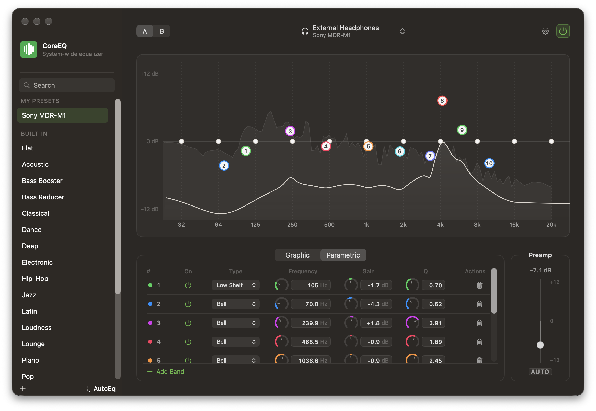

#+TITLE: CoreEQ
#+SUBTITLE: Системный эквалайзер для macOS

[[file:README.ar.org][العربية]] · [[file:README.cv.org][Чӑвашла]] · [[file:README.org][English]] · [[file:README.es.org][Español]] · [[file:README.fr.org][Français]] · [[file:README.ja.org][日本語]] · [[file:README.ru.org][Русский]] · [[file:README.nan-Hant.org][台語]] · [[file:README.zh-Hans.org][简体中文]] · [[file:README.zh-Hant.org][繁體中文]]

CoreEQ эквализует *всё, что вы слышите*, — музыку, видео, звонки, игры —
в каком бы приложении ни шёл звук, без виртуального аудиодрайвера и без
расширения ядра. Он работает на встроенном в Core Audio API перехвата звука
процессов, поэтому в систему ничего не устанавливается и ничего не остаётся,
когда CoreEQ не запущен.

* Главное

- *Все приложения, без драйвера.* В систему ничего не устанавливается — это
  можно проверить самому, — а при выходе из CoreEQ звук сразу возвращается.
- *Графический и параметрический в одной цепочке.* Одиннадцатиполосная
  октавная шкала ISO и до шестнадцати собственных фильтров: колоколов, полок,
  срезов.
- *Живой редактируемый график АЧХ*, построенный по тем же коэффициентам, через
  которые проходит звук, поверх анализатора спектра в реальном времени.
- *Двадцать два встроенных пресета и ваши собственные*; у каждого встроенного —
  описание в одну строку, для чего он.
- *Каталог AutoEq прямо в приложении*: ищите тысячи коррекций наушников по
  модели, прослушайте коррекцию перед сохранением и сохраните её как свой
  пресет. В сеть он выходит, только когда вы его открываете.
- *Импорт и экспорт AutoEq и EqualizerAPO*: коррекция откуда угодно
  загружается в пару щелчков.
- *Автоусиление* держит пресет на исходной громкости, так что при сравнении
  пресетов сравнивается звучание, а не громкость.
- *Сравнение A/B* двух версий одного пресета.
- *Настройки для каждого устройства вывода*: кривая ваших наушников
  возвращается вместе с наушниками.
- *Управление из строки меню* и быстрый эквалайзер (низы, середина, верха)
  поверх любого пресета.
- *Учитывает запись экрана*: CoreEQ отходит в сторону, пока запись экрана
  захватывает системный звук, чтобы звук в записи не двоился.
- *Приложения можно не трогать*: исключите DAW или любое другое приложение, и
  его звук пойдёт прямо на выход, без изменений (macOS 26 или новее).

Все возможности описаны в [[file:docs/USER_GUIDE.org][руководстве пользователя]] (на английском).

* Системные требования

- macOS *14.2* или новее
- Разрешение на обработку системного звука. CoreEQ объясняет, зачем оно нужно,
  и только потом запрашивает

* Установка

** Homebrew (рекомендуется)

#+begin_src sh
brew tap andreypudov/core-eq
brew trust andreypudov/core-eq
brew install --cask core-eq
#+end_src

Обновление: =brew update && brew upgrade --cask core-eq=.

CoreEQ подписан собственным сертификатом, благодаря чему разрешение на доступ к
звуку сохраняется между обновлениями, но Apple его не нотаризовала, поэтому
macOS может заблокировать первый запуск. Разрешите его в Системных настройках →
Конфиденциальность и безопасность или снимите флаг карантина:

#+begin_src sh
xattr -dr com.apple.quarantine /Applications/CoreEQ.app
#+end_src

** Сборка из исходного кода

Нужен Xcode 26 или новее. Собранные локально приложения не попадают в
карантин, поэтому CoreEQ запускается без предупреждений Gatekeeper:

#+begin_src sh
git clone https://github.com/AndreyPudov/core-eq.git
cd core-eq
make install
#+end_src

Команда собирает версию Release и устанавливает её в =/Applications=.

** Готовая сборка

Загрузите последний =CoreEQ-x.y.zip= со страницы *Releases*, распакуйте,
перенесите =CoreEQ.app= в =/Applications= и снимите флаг карантина, как
описано выше.

* Начало работы

1. Запустите CoreEQ. В строке меню появится значок с ползунками; значка в Dock
   нет.
2. Разрешите *Запись системного звука*. CoreEQ откроет окно, объяснит, зачем
   нужно разрешение, и запросит его, когда вы нажмёте *Разрешить…*: оно нужно,
   чтобы обрабатывать звук, который вы слышите. Ничего не записывается, не
   хранится и не передаётся.
3. Выберите пресет. Звук изменится сразу.

Что-то не работает? В [[file:docs/USER_GUIDE.org][руководстве пользователя]] есть раздел об устранении
неполадок, а Настройки → Диагностика формируют отчёт, который можно приложить к
сообщению об ошибке.

* Документация

Подробная документация — на английском.

| Документ                                  | О чём                                                   |
|-------------------------------------------+---------------------------------------------------------|
| [[file:docs/USER_GUIDE.org][Руководство пользователя]] | Все возможности, ограничения и устранение неполадок  |
| [[file:docs/RELEASE_NOTES.org][Примечания к выпускам]] | Что изменилось в каждом выпуске и как это нашли     |
| [[file:docs/ROADMAP.org][План развития]]          | Что дальше и в каком порядке                            |
| [[file:docs/DEVELOPMENT.org][Разработка]]         | Сборка, запуск и тестирование CoreEQ                    |
| [[file:docs/ARCHITECTURE.org][Архитектура]]       | Почему эквалайзер устроен именно так                    |
| [[file:docs/INTERNALS.org][Внутреннее устройство]] | Как собрано приложение: аудиотракт и всё остальное    |
| [[file:docs/RELEASING.org][Выпуск версий]]      | Непрерывная интеграция и выпуск версии                  |

[[file:docs/README.org][Указатель документации]] подскажет, с чего начать.

* Участие в разработке

Сообщения об ошибках и пул-реквесты приветствуются. В [[file:CONTRIBUTING.md][CONTRIBUTING.md]] описано,
что включить в сообщение об ошибке, формат сообщений коммитов и требования к
пул-реквестам; в [[file:SECURITY.md][SECURITY.md]] — как сообщить об уязвимости.

* Благодарности

Спасибо [[https://github.com/souljedi][Sebastian Ullrich (@souljedi)]] за импорт пресетов AutoEq и
EqualizerAPO ([[https://github.com/andreypudov/core-eq/pull/25][#25]]) — первый вклад в CoreEQ со стороны и самую востребованную
функцию — и за последовавший за ним браузер каталога AutoEq ([[https://github.com/andreypudov/core-eq/pull/40][#40]]).

Браузер каталога AutoEq в CoreEQ использует данные коррекции наушников из
[[https://github.com/jaakkopasanen/AutoEq][AutoEq]] Яакко Пасанена (Jaakko Pasanen) по лицензии MIT. Измерения взяты из
сторонних источников, таких как Oratory1990, Rtings и Innerfidelity; измерения
Crinacle исключены. У каждого результата указан источник.

* Лицензия

Apache License 2.0. См. [[file:LICENSE][LICENSE]].
